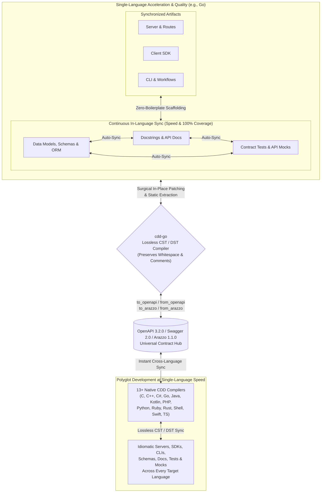

cdd-go: Go ⇄ OpenAPI
====================

[](https://opensource.org/licenses/Apache-2.0)
[](https://offscale.io/wasm_web_demo)
[](https://github.com/SamuelMarks/cdd-go/actions)
[](#)
[](#)

**cdd-go** compiles **[OpenAPI](https://spec.openapis.org/oas/latest.html) / [Swagger](https://spec.openapis.org/oas/v2.0.html) / [Arazzo](https://spec.openapis.org/arazzo/latest.html)** to and from **Go** (servers, client SDKs, CLIs, database schemas, tests, mocks, and docs), updating your existing code in-place without overwriting your edits.

**Compiler Driven Development (CDD)** is a software engineering methodology that uses a suite of standalone, lossless compilers to synchronize API specifications, server implementations, client SDKs, command-line tooling, workflow orchestrators, tests, and documentation.

Unlike traditional code generators that treat outputs as disposable or read-only, Compiler Driven Development provides a **complete, standalone compiler** (exposed as both a CLI and a programmatic SDK) written natively in each supported language. Where conventional compilers rely solely on an Abstract Syntax Tree (AST) that discards formatting and comments, CDD compilers operate on a **Concrete Syntax Tree (CST)** or **Decorated Syntax Tree (DST)**. This guarantees **lossless conversion**—preserving exact whitespace, indentation, inline comments, block comments, and docstrings—allowing true bidirectional synchronization between hand-edited `Go` source code and [OpenAPI 3.2.0](https://spec.openapis.org/oas/v3.2.0.html), [Swagger 2.0](https://spec.openapis.org/oas/v2.0.html), and [Arazzo 1.1.0](https://spec.openapis.org/arazzo/v1.1.0.html) specifications.

---

## Why Compiler Driven Development?

By replacing one-way templates and manual boilerplate with lossless CST/DST compilers, Compiler Driven Development transforms the engineering lifecycle across four dimensions:

- **Development Speed**: Eliminate manual boilerplate across servers, client SDKs, CLIs, database models, workflow runners, and mock servers. Start from an [OpenAPI](https://spec.openapis.org/oas/latest.html) or [Arazzo](https://spec.openapis.org/arazzo/latest.html) specification to scaffold an entire installable project (complete with package manifests and CI workflows), or write code first in `Go` and extract the specification automatically. When requirements change, update whichever representation is most convenient and synchronize the rest immediately.
- **Development Consistency**: Every data model, route handler, CLI flag, ORM entity, workflow step, and API contract is derived from and validated against the same semantic representation. Architectural drift between backend routes, frontend clients, and published specifications becomes structurally impossible.
- **Development Quality**: Keeping tests and documentation in lockstep with implementation code is automated rather than an afterthought. Because the compiler parses and emits docstrings, type signatures, API mocks, and contract test suites alongside your business logic, maintaining **100% documentation coverage and 100% test coverage** becomes a natural byproduct of compilation rather than a manual chore.
- **Polyglot Development**: Seamlessly bridge **13+ programming languages** (C, C++, C#, Go, Java, Kotlin, PHP, Python, Ruby, Rust, POSIX Shell, Swift, and TypeScript) to and from [OpenAPI](https://spec.openapis.org/oas/latest.html) and [Arazzo](https://spec.openapis.org/arazzo/latest.html) specifications. Any codebase in any supported language can be reverse-compiled into OpenAPI/Arazzo and immediately compiled forward into idiomatic, human-editable code across every other language in the suite. And being an open-source methodology—rather than a proprietary trade secret—new languages can be added by implementing new compilers that follow the CDD approach (see [cdd-spec-conformance](https://github.com/SamuelMarks/cdd-spec-conformance) for tooling to facilitate).

---

## The Standalone Compiler Architecture and Lossless Conversion

Traditional code generation tools rely on destructive templating: if you regenerate your project from an updated specification, your custom implementation logic, formatting, and comments are overwritten.

Each Compiler Driven Development toolchain is written natively in its target language, compiles both to native binaries and to **WebAssembly (WASM/WASI)**, and implements a full lexer, parser, semantic differ, and code emitter backed by Concrete Syntax Tree (CST) and Decorated Syntax Tree (DST) representations:

- **Beyond AST to CST/DST**: A standard Abstract Syntax Tree (AST) captures program semantics while stripping away "trivia" (whitespace, blank lines, and comments). By pairing structural AST semantics with a Concrete Syntax Tree (CST) or Decorated Syntax Tree (DST) that attaches trivia and structured documentation directly to syntax nodes, the compiler preserves 100% of your source formatting and comments.
- **Zero-Destruction Guarantee**: Every part of the generated codebase is designed to be edited by humans. You can open generated routing files, data models, database entities, workflow runners, tests, and CLI commands, format them to your preferences, add inline comments, and inject custom business logic.
- **When your specification changes**: The CDD compiler parses your existing source files into a CST/DST, computes a semantic diff against the updated [OpenAPI](https://spec.openapis.org/oas/latest.html) or [Arazzo](https://spec.openapis.org/arazzo/latest.html) specification, and surgically patches in new endpoints, workflows, parameters, or fields without disturbing your custom logic, comments, or whitespace.
- **When your codebase changes**: The compiler statically analyzes your updated source code, routes, workflows, tests, and docstrings—without unsafe dynamic code execution or reflection—to extract a 100% compliant, authoritative [OpenAPI](https://spec.openapis.org/oas/latest.html) or [Arazzo](https://spec.openapis.org/arazzo/latest.html) specification.

---

## The Bidirectional Synchronization Loop



The Compiler Driven Development lifecycle delivers compounding returns in both single-language and polyglot environments:
1. **Single-Language Speed**: Edit whichever artifact is most convenient—models/schemas, route handlers, docstrings, or tests—and let `cdd-go` surgically synchronize the rest in-place without overwriting your custom logic, comments, or whitespace.
2. **Single-Language Quality**: Because schemas, documentation, contract tests, and mocks are continuously cross-compiled rather than manually maintained, **100% doc coverage and 100% test coverage** are enforced automatically on every sync.
3. **Polyglot Development at Single-Language Speed**: Extracting an authoritative [OpenAPI](https://spec.openapis.org/oas/latest.html) or [Arazzo](https://spec.openapis.org/arazzo/latest.html) contract from one language immediately drives lossless forward-compilation across all 13+ supported languages—making multi-language SDK, CLI, and service maintenance just as fast as working in a single codebase.

---

## Core Capabilities Shared Across All CDD Compilers

Every `cdd-*` repository in the suite implements the same foundational feature set:

- **Bidirectional OpenAPI 3.2.0 & Swagger 2.0 Compilation**:
  - `from_openapi`: Generate idiomatic `Go` Client SDKs (`to_sdk`), Client CLIs (`to_sdk_cli`), and Server stubs/routers (`to_server`) from a single specification (`-i`) or a batch directory of specifications (`--input-dir`). Automatically upgrades legacy Swagger 2.0 and OpenAPI 3.0/3.1 specifications to OpenAPI 3.2.0.
  - `to_openapi`: Statically parse existing `Go` source files or directories to extract a compliant OpenAPI 3.2.0 specification.
- **Bidirectional Arazzo 1.1.0 Workflow Orchestration**:
  - `from_arazzo`: Compile multi-step [Arazzo 1.1.0](https://spec.openapis.org/arazzo/v1.1.0.html) workflow specifications (including runtime expressions, step DAGs, criterion evaluations, and failure/success actions) into `Go` SDK workflow orchestrators (`to_sdk`), CLI workflow runners (`to_sdk_cli`), and Server/E2E workflow test suites (`to_server`).
  - `to_arazzo`: Reverse-parse `Go` workflow orchestrators, CLI scripts, or E2E test suites back into an authoritative Arazzo 1.1.0 document.
- **In-Place Codebase Synchronization (`sync`)**:
  - Synchronize data models, ORM schemas, route handlers, docstrings, contract tests, mocks, and specifications in-place using lossless CST/DST patching.
- **Documentation Code-Snippet Generation (`to_docs_json`)**:
  - Emit a structured JSON documentation payload containing idiomatic `Go` request/workflow code snippets for every operation in an OpenAPI specification (with `--no-imports` and `--no-wrapping` options for embedding in documentation portals).
- **Composable Contract Tests, Mocks, CI, and Package Scaffolding**:
  - By default, `from_openapi` and `from_arazzo` scaffold complete, installable `Go` packages and `.github/workflows/ci.yml` pipelines (configurable via `--no-installable-package` and `--no-github-actions`), and generate contract test suites and API mocks/fakes via `--tests`.
- **Model Context Protocol (`mcp`) & JSON-RPC (`serve_json_rpc`)**:
  - Run `cdd-go mcp` to expose the compiler over stdio as an [MCP](https://modelcontextprotocol.io/) server for AI assistants and IDEs, or pass `--mcp` during generation to emit MCP tool/resource adapters directly inside generated SDKs and servers.
  - Run `cdd-go serve_json_rpc` to expose the compiler's full API over JSON-RPC 2.0 (`--port`, `--listen`).
- **Native CLI, Programmatic SDK, and WebAssembly (WASM/WASI)**:
  - Use `cdd-go` from the command line, import its programmatic SDK directly into `Go` applications, or run it in the browser and WASI runtimes via its WebAssembly build (see [WASM.md](WASM.md)).

---

## The Global Polyglot Ecosystem

Every supported language operates on the same core Compiler Driven Development principles and is powered by a dedicated, native compiler tailored to that language's syntax tree, idioms, and package manager.

All implementations expose a standardized command-line interface (`cdd-go <subcommand>`) and programmatic SDK.

| Repository | Language | Targets (`to_sdk`; `to_sdk_cli`; `to_server`) | Special Features Beyond Common Subset | Standards | CI Status |
|---|---|---|---|---|---|
| [`cdd-c`](https://github.com/SamuelMarks/cdd-c) | C (C89) | Client; Client CLI; Server | 42-Language FFI Generator (`bind`); GNU-to-C89 AST Lowering; Safe CRT & Memory Security Auditor; `c-orm` Migrations | [Arazzo 1.1.0](https://spec.openapis.org/arazzo/v1.1.0.html); [Swagger 2.0](https://spec.openapis.org/oas/v2.0.html); [OpenAPI 3.2.0](https://spec.openapis.org/oas/v3.2.0.html); [MCP](https://modelcontextprotocol.io/) | [](https://github.com/SamuelMarks/cdd-c/actions/workflows/ci.yml) |
| [`cdd-cpp`](https://github.com/SamuelMarks/cdd-cpp) | C++ | Client; Client CLI; Server | [Google Discovery](https://developers.google.com/discovery) (`from_google_discovery`); PostgreSQL `libpq` ORM & Faker Support | [Google Discovery](https://developers.google.com/discovery); [Arazzo 1.1.0](https://spec.openapis.org/arazzo/v1.1.0.html); [Swagger 2.0](https://spec.openapis.org/oas/v2.0.html); [OpenAPI 3.2.0](https://spec.openapis.org/oas/v3.2.0.html); [MCP](https://modelcontextprotocol.io/) | [](https://github.com/SamuelMarks/cdd-cpp/actions/workflows/ci.yml) |
| [`cdd-csharp`](https://github.com/SamuelMarks/cdd-csharp) | C# | Client; Client CLI; Server | CLR & Roslyn CST/DST Trivia-Preserving Sync; Entity Framework & Minimal API Targets | [Arazzo 1.1.0](https://spec.openapis.org/arazzo/v1.1.0.html); [Swagger 2.0](https://spec.openapis.org/oas/v2.0.html); [OpenAPI 3.2.0](https://spec.openapis.org/oas/v3.2.0.html); [MCP](https://modelcontextprotocol.io/) | [](https://github.com/SamuelMarks/cdd-csharp/actions/workflows/ci.yml) |
| [`cdd-go`](https://github.com/SamuelMarks/cdd-go) | Go | Client; Client CLI; Server | Go `dst`/`ast` Surgical Patching; Multi-Source Truth Sync (`code` ⇄ `openapi`) | [Arazzo 1.1.0](https://spec.openapis.org/arazzo/v1.1.0.html); [Swagger 2.0](https://spec.openapis.org/oas/v2.0.html); [OpenAPI 3.2.0](https://spec.openapis.org/oas/v3.2.0.html); [MCP](https://modelcontextprotocol.io/) | [](https://github.com/SamuelMarks/cdd-go/actions/workflows/ci.yml) |
| [`cdd-java`](https://github.com/SamuelMarks/cdd-java) | Java | Client; Client CLI; Server | JavaParser CST Lexical Preservation; WASI JSON-RPC Mode; In-Memory Compiler Pipeline | [Arazzo 1.1.0](https://spec.openapis.org/arazzo/v1.1.0.html); [Swagger 2.0](https://spec.openapis.org/oas/v2.0.html); [OpenAPI 3.2.0](https://spec.openapis.org/oas/v3.2.0.html); [MCP](https://modelcontextprotocol.io/) | [](https://github.com/SamuelMarks/cdd-java/actions/workflows/ci.yml) |
| [`cdd-kotlin`](https://github.com/offscale/cdd-kotlin) | Kotlin (Ktor Multiplatform) | Client; Client CLI; Server | Multiplatform Auto-Admin UI; Ephemeral & Seeded Mock Server Modes; Webhook Triggers | [Arazzo 1.1.0](https://spec.openapis.org/arazzo/v1.1.0.html); [Swagger 2.0](https://spec.openapis.org/oas/v2.0.html); [OpenAPI 3.2.0](https://spec.openapis.org/oas/v3.2.0.html); [MCP](https://modelcontextprotocol.io/) | [](https://github.com/offscale/cdd-kotlin/actions/workflows/ci.yml) |
| [`cdd-php`](https://github.com/SamuelMarks/cdd-php) | PHP | Client; Client CLI; Server | Multi-Tiered DAO (`StubDao` / `ConcreteDao`); Ephemeral & Faker-Seeded SQLite Server Modes | [Arazzo 1.1.0](https://spec.openapis.org/arazzo/v1.1.0.html); [Swagger 2.0](https://spec.openapis.org/oas/v2.0.html); [OpenAPI 3.2.0](https://spec.openapis.org/oas/v3.2.0.html); [MCP](https://modelcontextprotocol.io/) | [](https://github.com/SamuelMarks/cdd-php/actions/workflows/ci.yml) |
| [`cdd-python`](https://github.com/offscale/cdd-python) | Python | N/A (server building blocks) | CLI ⇄ SQLAlchemy ⇄ Pydantic ⇄ Docs ⇄ JSON Schema | N/A | [](https://github.com/offscale/cdd-python/actions) |
| [`cdd-python-all`](https://github.com/offscale/cdd-python-all) | Python | Client; Client CLI; Server | `LibCST` Lossless Sync; Multi-Truth Sync (`class`, `sqlalchemy`, `function`, `openapi`); FastAPI + SQLAlchemy | [Arazzo 1.1.0](https://spec.openapis.org/arazzo/v1.1.0.html); [Swagger 2.0](https://spec.openapis.org/oas/v2.0.html); [OpenAPI 3.2.0](https://spec.openapis.org/oas/v3.2.0.html); [MCP](https://modelcontextprotocol.io/) | [](https://github.com/offscale/cdd-python-all/actions/workflows/ci.yml) |
| [`cdd-ruby`](https://github.com/SamuelMarks/cdd-ruby) | Ruby | Client; Client CLI; Server | ActiveRecord Sync (`class`, `activerecord`, `function`); Ephemeral & Seeded Server Generation | [Arazzo 1.1.0](https://spec.openapis.org/arazzo/v1.1.0.html); [Swagger 2.0](https://spec.openapis.org/oas/v2.0.html); [OpenAPI 3.2.0](https://spec.openapis.org/oas/v3.2.0.html); [MCP](https://modelcontextprotocol.io/) | [](https://github.com/SamuelMarks/cdd-ruby/actions/workflows/ci.yml) |
| [`cdd-rust`](https://github.com/SamuelMarks/cdd-rust) | Rust | Client; Client CLI; Server | Actix-Web, Axum & Reqwest Targets; Diesel Schema Sync; Standalone `schema-gen`, `scaffold` & `test-gen` | [Arazzo 1.1.0](https://spec.openapis.org/arazzo/v1.1.0.html); [Swagger 2.0](https://spec.openapis.org/oas/v2.0.html); [OpenAPI 3.2.0](https://spec.openapis.org/oas/v3.2.0.html); [MCP](https://modelcontextprotocol.io/) | [](https://github.com/SamuelMarks/cdd-rust/actions/workflows/ci.yml) |
| [`cdd-sh`](https://github.com/SamuelMarks/cdd-sh) | Shell (`/bin/sh`) | Client; Client CLI; Server | Zero-Dependency Embedded `sh`/`jq`/`awk` Cross-Platform Binary; Direct AST `parse` & `emit` Subcommands | [Arazzo 1.1.0](https://spec.openapis.org/arazzo/v1.1.0.html); [Swagger 2.0](https://spec.openapis.org/oas/v2.0.html); [OpenAPI 3.2.0](https://spec.openapis.org/oas/v3.2.0.html); [MCP](https://modelcontextprotocol.io/) | [](https://github.com/SamuelMarks/cdd-sh/actions/workflows/ci.yml) |
| [`cdd-swift`](https://github.com/SamuelMarks/cdd-swift) | Swift | Client; Client CLI; Server | `SwiftSyntax` Lossless Merging (`merge_swift`); Vapor + Fluent ORM Scaffolding; `sync_arazzo` | [Arazzo 1.1.0](https://spec.openapis.org/arazzo/v1.1.0.html); [Swagger 2.0](https://spec.openapis.org/oas/v2.0.html); [OpenAPI 3.2.0](https://spec.openapis.org/oas/v3.2.0.html); [MCP](https://modelcontextprotocol.io/) | [](https://github.com/SamuelMarks/cdd-swift/actions/workflows/ci.yml) |
| [`cdd-ts`](https://github.com/offscale/cdd-ts) | TypeScript | Client; Client CLI; Server | Auto-Admin UI; Angular, React, Vue, Vanilla; Fetch, Axios, Node; Express, Bun, Deno; TypeORM Sync | [Arazzo 1.1.0](https://spec.openapis.org/arazzo/v1.1.0.html); [Swagger 2.0](https://spec.openapis.org/oas/v2.0.html); [OpenAPI 3.2.0](https://spec.openapis.org/oas/v3.2.0.html); [MCP](https://modelcontextprotocol.io/) | [](https://github.com/offscale/cdd-ts/actions/workflows/ci.yml) |

---

## Programmatic SDK & CLI Quickstart

Every `cdd-*` toolchain can be invoked either as a standalone CLI binary or imported as a native `Go` library.

### Minimal CLI Usage

```sh
# Print help and version
cdd-go --help
cdd-go --version

# Generate a Go Client SDK, Client CLI, or Server from an OpenAPI spec
cdd-go from_openapi to_sdk -i spec.json -o ./sdk --tests
cdd-go from_openapi to_sdk_cli -i spec.json -o ./cli --tests
cdd-go from_openapi to_server -i spec.json -o ./server --tests

# Extract an OpenAPI 3.2.0 spec from existing Go source code
cdd-go to_openapi -i ./src -o openapi.json

# Generate and extract Arazzo 1.1.0 multi-step workflows
cdd-go from_arazzo to_sdk -i workflow.arazzo.json -o ./workflows --tests
cdd-go from_arazzo to_sdk_cli -i workflow.arazzo.json -o ./workflow-cli --tests
cdd-go from_arazzo to_server -i workflow.arazzo.json -o ./workflow-server --tests
cdd-go to_arazzo -i ./workflows -o extracted.arazzo.json

# Synchronize codebase models, routes, tests, docs, and OpenAPI in-place
cdd-go sync -i ./src -o openapi.json

# Generate documentation-ready Go code snippets JSON for an OpenAPI spec
cdd-go to_docs_json --no-imports --no-wrapping -i spec.json -o docs.json

# Run as a Model Context Protocol (MCP) server over stdio or JSON-RPC 2.0 server
cdd-go mcp
cdd-go serve_json_rpc --port 8080 --listen 127.0.0.1
```

### Programmatic SDK Example

```go
package main

import (
	"log"

	"github.com/SamuelMarks/cdd-go/cdd"
)

func main() {
	// 1. Generate a Go HTTP Server (Gin routes, GORM models, DAOs, tests, and MCP adapters) from OpenAPI
	if err := cdd.FromOpenAPI("to_server", "spec.json", "./server", false, false, true, true); err != nil {
		log.Fatalf("FromOpenAPI failed: %v", err)
	}

	// 2. Statically parse Go source code into an OpenAPI 3.2.0 specification
	if err := cdd.ToOpenAPI("./server", "openapi.json"); err != nil {
		log.Fatalf("ToOpenAPI failed: %v", err)
	}

	// 3. Synchronize Go code and OpenAPI specification in-place
	if err := cdd.Sync("./server", "openapi.json", "code"); err != nil {
		log.Fatalf("Sync failed: %v", err)
	}

	// 4. Generate and extract Arazzo 1.1.0 multi-step workflows
	if err := cdd.FromArazzo("to_sdk", "workflow.arazzo.json", "./workflows", false, false, true); err != nil {
		log.Fatalf("FromArazzo failed: %v", err)
	}
	if err := cdd.ToArazzo("./workflows", "extracted.arazzo.json"); err != nil {
		log.Fatalf("ToArazzo failed: %v", err)
	}

	// 5. Generate documentation-ready Go code snippets JSON
	if err := cdd.ToDocsJSON("spec.json", "docs.json", false, false); err != nil {
		log.Fatalf("ToDocsJSON failed: %v", err)
	}
}
```

### Installation & Development

All `cdd-*` repositories support both native language build tools and a standardized cross-platform `Makefile` / `make.bat` interface (`deps`, `build`, `test`):

```sh
make deps
make build
make test
# or on Windows:
.\make.bat deps
.\make.bat build
.\make.bat test
```

```sh
# Install the CLI binary directly via Go toolchain
go install github.com/SamuelMarks/cdd-go/cmd/cdd-go@latest

# Or build, test, and verify 100% test & doc coverage from source
go mod download
go build -o bin/cdd-go ./cmd/cdd-go
go vet ./...
go test -v -coverprofile=coverage.out ./cmd/... ./src/... ./cdd/...
go tool cover -func=coverage.out
go run ./scripts/doc_cover/doc_cover.go

# Compile to WebAssembly (WASI / Browser)
GOOS=wasip1 GOARCH=wasm go build -o bin/cdd-go.wasm ./cmd/cdd-go
```

> **Further Documentation**:
> - [**ARCHITECTURE.md**](ARCHITECTURE.md) — Compiler pipeline (Lexer → CST/DST/AST → Semantic Diff → Emitter).
> - [**COMPLIANCE.md**](COMPLIANCE.md) — Swagger 2.0, OpenAPI 3.2.0, Arazzo 1.1.0, and MCP support matrices.
> - [**USAGE.md**](USAGE.md) — Detailed CLI, SDK, ORM, and roundtrip usage guide.
> - [**DEVELOPING.md**](DEVELOPING.md) — Local development, linting, testing, and coverage guide.
> - [**WASM.md**](WASM.md) — WebAssembly / WASI build and browser/Node.js execution instructions.
> - [**PUBLISH.md**](PUBLISH.md) — Package publishing and release workflow.

---

## Universal CLI Toolchain

Once you learn the Compiler Driven Development CLI in one language, you can use the exact same commands, flags, and environment variables across the entire polyglot stack.

### Common Arguments & Environment Variables

| Flag | Short | Environment Variable | Description |
|---|---|---|---|
| `--help` | `-h` | — | Print help information for the CLI or subcommand. |
| `--version` | `-v` / `-V` | — | Print version information. |
| `--input <path>` | `-i` / `-f` | `CDD_INPUT` | Path or URL to the input OpenAPI/Arazzo spec or source file/directory. |
| `--input-dir <dir>` | `-d` | `CDD_INPUT_DIR` | Directory containing multiple OpenAPI/Arazzo specifications for batch generation. |
| `--output <path>` | `-o` | `CDD_OUTPUT` | Destination file or directory path for generated code or extracted specifications. |
| `--tests` | `-t` | `CDD_TESTS` | Generate composable contract/integration tests and API mocks alongside code. |
| `--mcp` | `-m` | `CDD_MCP` | Generate Model Context Protocol (MCP) server and client adapters. |
| `--no-github-actions` | — | `CDD_NO_GITHUB_ACTIONS` | Do not generate `.github/workflows/ci.yml` scaffolding in target output. |
| `--no-installable-package` | — | `CDD_NO_INSTALLABLE_PACKAGE` | Do not generate package manifest/build files in target output. |
| `--no-imports` | — | `CDD_NO_IMPORTS` | (`to_docs_json`) Omit import/include statements from generated documentation snippets. |
| `--no-wrapping` | — | `CDD_NO_WRAPPING` | (`to_docs_json`) Omit boilerplate wrapper functions/classes from documentation snippets. |
| `--port <port>` | `-p` | `CDD_PORT` | (`serve_json_rpc`) TCP port to listen on (default: `8080`). |
| `--listen <addr>` | `-l` | `CDD_LISTEN` | (`serve_json_rpc`) Host/IP address to bind to (default: `127.0.0.1`). |
| `--truth <source>` | `-t` | `CDD_TRUTH` | (`sync`) Designate the single source of truth when synchronizing. |

### Core Subcommands

- **`from_openapi [to_sdk | to_sdk_cli | to_server]`**: Compile an OpenAPI 3.2.0 or Swagger 2.0 specification into an idiomatic `Go` Client SDK, Client CLI, or HTTP Server (patching existing files losslessly if the target directory already exists).
- **`to_openapi`**: Statically parse `Go` models, routes, client calls, and docstrings into an authoritative OpenAPI 3.2.0 specification.
- **`from_arazzo [to_sdk | to_sdk_cli | to_server]`**: Compile an Arazzo 1.1.0 workflow specification into `Go` workflow orchestrators, CLI workflow runners, or server/E2E workflow test suites.
- **`to_arazzo`**: Statically parse `Go` workflow code, CLI scripts, or E2E tests into an Arazzo 1.1.0 specification.
- **`sync`**: Bidirectionally synchronize `Go` source files (models, ORM entities, routes, functions, tests, and docstrings) with OpenAPI/Arazzo specifications in-place.
- **`to_docs_json`**: Generate documentation-optimized JSON containing `Go` code snippets for each operation in an OpenAPI specification.
- **`serve_json_rpc`**: Expose the `cdd-go` compiler over a JSON-RPC 2.0 server for IDE integrations and external tooling.
- **`mcp`**: Run the `cdd-go` compiler as a Model Context Protocol (MCP) server over standard I/O (`stdio`).

### Verbatim CLI Help Output

#### `cdd-go --help`
```text
cdd-go is a Code-Driven Development tool for Go.

Usage:
  cdd-go [subcommand] [flags]

Subcommands:
  from_openapi    Generate code from an OpenAPI specification.
  to_openapi      Generate an OpenAPI specification from source code.
  from_arazzo     Generate code from an Arazzo 1.1.0 specification.
  to_arazzo       Generate an Arazzo 1.1.0 specification from source code.
  sync            Synchronize an OpenAPI or Arazzo specification with source code.
  to_docs_json    Generate JSON documentation with code snippets for an OpenAPI specification.
  serve_json_rpc  Expose CLI interface as a JSON-RPC server.
  mcp             Run the generator as an MCP server over stdio.

Flags:
  -h, --help       Show this help message
  -v, --version    Show version information
```

#### `from_openapi`
```text
Usage of from_openapi:
  cdd-go from_openapi [to_sdk | to_sdk_cli | to_server] [flags]
```

#### `from_openapi to_sdk`
```text
Usage of from_openapi to_sdk:
  -d string
        Directory containing OpenAPI specifications.
  -i string
        Path or URL to the OpenAPI specification.
  -input string
        Path or URL to the OpenAPI specification.
  -input-dir string
        Directory containing OpenAPI specifications.
  -m    Generate Model Context Protocol (MCP) server and adapter.
  -mcp
        Generate Model Context Protocol (MCP) server and adapter.
  -no-github-actions
        Do not generate GitHub Actions scaffolding.
  -no-installable-package
        Do not generate installable package scaffolding.
  -o string
        Output file or directory path.
  -output string
        Output file or directory path.
  -tests
        Generate integration tests and mocks.
```

#### `from_openapi to_sdk_cli`
```text
Usage of from_openapi to_sdk_cli:
  -d string
        Directory containing OpenAPI specifications.
  -i string
        Path or URL to the OpenAPI specification.
  -input string
        Path or URL to the OpenAPI specification.
  -input-dir string
        Directory containing OpenAPI specifications.
  -m    Generate Model Context Protocol (MCP) server and adapter.
  -mcp
        Generate Model Context Protocol (MCP) server and adapter.
  -no-github-actions
        Do not generate GitHub Actions scaffolding.
  -no-installable-package
        Do not generate installable package scaffolding.
  -o string
        Output file or directory path.
  -output string
        Output file or directory path.
  -tests
        Generate integration tests and mocks.
```

#### `from_openapi to_server`
```text
Usage of from_openapi to_server:
  -d string
        Directory containing OpenAPI specifications.
  -i string
        Path or URL to the OpenAPI specification.
  -input string
        Path or URL to the OpenAPI specification.
  -input-dir string
        Directory containing OpenAPI specifications.
  -m    Generate Model Context Protocol (MCP) server and adapter.
  -mcp
        Generate Model Context Protocol (MCP) server and adapter.
  -no-github-actions
        Do not generate GitHub Actions scaffolding.
  -no-installable-package
        Do not generate installable package scaffolding.
  -o string
        Output file or directory path.
  -output string
        Output file or directory path.
  -tests
        Generate integration tests and mocks.
```

#### `to_openapi`
```text
Usage of to_openapi:
  -i string
        Path to source code directory or file.
  -input string
        Path to source code directory or file.
  -o string
        Output file or directory path. (default "openapi.json")
  -output string
        Output file or directory path. (default "openapi.json")
```

#### `from_arazzo`
```text
Usage of from_arazzo:
  cdd-go from_arazzo [to_sdk | to_sdk_cli | to_server] [flags]
```

#### `from_arazzo to_sdk`
```text
Usage of from_arazzo to_sdk:
  -d string
        Directory containing Arazzo specifications.
  -i string
        Path to the Arazzo 1.1.0 specification.
  -input string
        Path to the Arazzo 1.1.0 specification.
  -input-dir string
        Directory containing Arazzo specifications.
  -no-github-actions
        Do not generate GitHub Actions scaffolding.
  -no-installable-package
        Do not generate installable package scaffolding.
  -o string
        Output directory path.
  -output string
        Output directory path.
  -tests
        Generate workflow E2E tests.
```

#### `from_arazzo to_sdk_cli`
```text
Usage of from_arazzo to_sdk_cli:
  -d string
        Directory containing Arazzo specifications.
  -i string
        Path to the Arazzo 1.1.0 specification.
  -input string
        Path to the Arazzo 1.1.0 specification.
  -input-dir string
        Directory containing Arazzo specifications.
  -no-github-actions
        Do not generate GitHub Actions scaffolding.
  -no-installable-package
        Do not generate installable package scaffolding.
  -o string
        Output directory path.
  -output string
        Output directory path.
  -tests
        Generate workflow E2E tests.
```

#### `from_arazzo to_server`
```text
Usage of from_arazzo to_server:
  -d string
        Directory containing Arazzo specifications.
  -i string
        Path to the Arazzo 1.1.0 specification.
  -input string
        Path to the Arazzo 1.1.0 specification.
  -input-dir string
        Directory containing Arazzo specifications.
  -no-github-actions
        Do not generate GitHub Actions scaffolding.
  -no-installable-package
        Do not generate installable package scaffolding.
  -o string
        Output directory path.
  -output string
        Output directory path.
  -tests
        Generate workflow E2E tests.
```

#### `to_arazzo`
```text
Usage of to_arazzo:
  -i string
        Path to source code directory or file.
  -input string
        Path to source code directory or file.
  -o string
        Output file or directory path. (default "arazzo.json")
  -output string
        Output file or directory path. (default "arazzo.json")
```

#### `sync`
```text
Usage of sync:
  -i string
        Input path (source dir or openapi spec).
  -input string
        Input path (source dir or openapi spec).
  -o string
        Output file or directory path. (default "openapi.json")
  -output string
        Output file or directory path. (default "openapi.json")
  -t string
        Source of truth: 'code' (or 'go'), 'openapi' (or 'spec', 'swagger'), 'arazzo'. (default "code")
  -truth string
        Source of truth: 'code' (or 'go'), 'openapi' (or 'spec', 'swagger'), 'arazzo'. (default "code")
```

#### `to_docs_json`
```text
Usage of to_docs_json:
  -i string
        Path or URL to the OpenAPI specification.
  -input string
        Path or URL to the OpenAPI specification.
  -no-imports
        Omit the imports field.
  -no-wrapping
        Omit the wrapper fields.
  -o string
        Output file or directory path.
  -output string
        Output file or directory path.
```

#### `serve_json_rpc`
```text
Usage of serve_json_rpc:
  -l string
        Address to listen on (shorthand) (default "127.0.0.1")
  -listen string
        Address to listen on (default "127.0.0.1")
  -p int
        Port to listen on (shorthand) (default 8080)
  -port int
        Port to listen on (default 8080)
```

#### `mcp`
```text
Usage of mcp:
  Run the Model Context Protocol (MCP) server over standard I/O (stdio).
```

---

## Special Features Beyond the Common Compiler Driven Development Subset

While all compilers in this suite implement the full shared baseline above, `cdd-go` implements additional capabilities tailored to the `Go` ecosystem:

### 1. Lossless Go Decorated Syntax Tree (`dave/dst`) Surgical Patching
- **Comment & Trivia Preservation (`src/classes`, `src/routes`, `src/clients`, `src/commands`, `src/functions`, `src/docstrings`)**: Built on top of [`github.com/dave/dst`](https://github.com/dave/dst) and standard `go/parser`/`go/token`, `cdd-go` parses existing `.go` files into a Decorated Syntax Tree (`*dst.File`) and merges declarations via `mergeDecls` (`cdd/cdd.go`).
- **Non-Destructive In-Place Merging**: When regenerating over an existing directory, `cdd-go` matches existing `token.TYPE`, `token.VAR`, `token.CONST`, and `*dst.FuncDecl` nodes by name and receiver, updating structural signatures while preserving surrounding user functions, custom business logic, inline comments, and docstrings.

### 2. Multi-Source Truth Synchronization (`code` ⇄ `openapi` ⇄ `arazzo`)
- **Flexible `--truth` / `-t` (`CDD_TRUTH`) Modes**:
  - `code` (or `go`): Statically analyzes a Go codebase and emits either an OpenAPI 3.2.0 specification (`.json`/`.yaml`) or an Arazzo 1.1.0 specification (when the output filename ends with `arazzo.json`, `arazzo.yaml`, or `arazzo.yml`).
  - `openapi` (or `spec`, `swagger`): Uses the OpenAPI/Swagger specification as the source of truth and patches the target Go codebase in-place (`to_sdk`).
  - `arazzo`: Uses an Arazzo 1.1.0 workflow specification as the source of truth and patches the target Go workflow SDK (`to_sdk`) in-place.

### 3. Gin-Gonic Web Server, Middleware, and Integrated Mock IdP Generation (`to_server`)
- **Gin-Gonic Route Handlers (`src/routes`, `cdd/server_main_gen.go`)**: Generates strongly-typed `Handler<Path>` interfaces, `handler<Path>` implementations with injected `daos.DAOFactory`, and a complete `cmd/server/main.go` entrypoint powered by `github.com/gin-gonic/gin`.
- **Decoupled CDD Server Modes**:
  - `start` (No DB configured): **Stub Mode**. Server runs using traditional scaffolds, endpoints return `NotImplementedError` (`501 Not Implemented`) or empty bodies.
  - `start` (With `DATABASE_URL`): **Production Mode**. Uses actual ORM interactions against a real PostgreSQL database.
  - `start --ephemeral`: **Sandbox Mode**. Uses actual ORM interactions against a fresh, throwaway in-memory SQLite database.
  - `start --ephemeral --seed`: **Full Mock Mode**. Ephemeral database, automatically populated with a localized fake data graph on startup.
- **Runtime Server Mode Flags**: Generated server binaries accept `--ephemeral` (triggers Concrete DAOs and overrides `DATABASE_URL` with a throwaway database), `--seed` (runs the fake data seeder on startup), `--strict-validation` (enforces strict OpenAPI request schema validation), and `--enforce-auth` (enforces mock JWT/Bearer authentication) alongside `DATABASE_URL` environment variables.
- **Administrative Webhook & Callback Trigger API (`src/webhooks/trigger.go`, `cdd/server_main_gen.go`)**: When an OpenAPI specification defines `webhooks` or `callbacks`, the generated mock server exposes `POST /_mock/trigger-webhook/{webhook_name}` and dispatches outgoing JSON webhook payloads to a registered `target_url` via its internal HTTP client.
- **Global Middlewares (`cdd/middlewares_gen.go`)**: Automatically scaffolds `middlewares/middlewares.go` with `CORSMiddleware()`, `AuthMockMiddleware(enforceAuth bool)`, and `ValidationMiddleware(strict bool)`.
- **Integrated Mock Identity Provider (`cdd/idp_gen.go`)**: Automatically generates `idp/idp_handlers.go` with `HandleRegister` (`POST /auth/register`) and `HandleLogin` (`POST /auth/login`) returning mock Bearer tokens for local OAuth2/JWT testing.

### 4. Multi-Tiered GORM ORM, Ephemeral SQLite, PostgreSQL, and Faker Seeding
- **GORM Model & Tag Emission (`src/classes`)**: Emits Go model structs with dual `` `json:"..." gorm:"column:..."` `` struct tags and parses them back into OpenAPI `components.schemas`.
- **Three-Tier DAO Architecture (`src/daos`, `cdd/dao_gen.go`)**:
  - **Abstract Interface (`<Model>DAO`)**: Context-aware CRUD methods (`Create`, `Get`, `Update`, `Delete`, `List`).
  - **Stub Implementation (`<Model>StubDAO`)**: Zero-dependency stub returning `models.NewNotImplementedError()` (`501 Not Implemented`).
  - **Concrete GORM Implementation (`<Model>GormDAO`)**: Full `gorm.io/gorm` implementation with `WithContext(ctx)` support.
  - **Factory Dispatcher (`DAOFactory`, `NewDAOFactory`)**: Dynamically wires either `StubDAO` or `GormDAO` per entity based on whether a `*gorm.DB` connection is active, paired with auto-generated `daos/daos_test.go` unit tests using `github.com/DATA-DOG/go-sqlmock`.
- **Database Auto-Migration (`src/database`, `cdd/database_gen.go`)**: Emits `database/database.go` supporting both ephemeral shared in-memory SQLite (`gorm.io/driver/sqlite` with `file::memory:?cache=shared`) and production PostgreSQL (`gorm.io/driver/postgres`) with automatic `db.AutoMigrate(...)` across all component schemas.
- **Referential-Integrity Faker Seeder (`src/seeder`, `cdd/seeder_gen.go`)**: Emits `seed/seeder.go` using `github.com/brianvoe/gofakeit/v6` with an `EntityPool` ID cache and per-model `Fake<Model>(pool EntityPool)` factories.

### 5. Full Arazzo 1.1.0 Workflow Compiler & Runtime Expression Engine (`src/arazzo`, `src/workflows`)
- **Arazzo 1.1.0 Parser, Validator & Cycle-Checking DAG (`src/arazzo`)**: Full support for Arazzo 1.1.0 `sourceDescriptions` (`openapi`, `arazzo`, `asyncapi`), `workflows`, `steps`, `dependsOn` cycle detection via DFS, `successCriteria` (`simple`, `regex`, `jsonpath`, `xpath`), `onSuccess`/`onFailure` actions (`end`, `goto`, `retry` with `retryAfter`/`retryLimit`), `payloadReplacements`, and specification extensions (`x-*`).
- **Runtime Expression Evaluator (`src/arazzo/expressions.go`)**: Parses and evaluates `$url`, `$method`, `$statusCode`, `$request.header.*`, `$request.query.*`, `$request.path.*`, `$request.body#/...` (RFC 6901 JSON Pointer), `$response.header.*`, `$response.body#/...`, `$message.header.*`, `$message.payload#/...`, `$inputs.*`, `$outputs.*`, `$steps.<id>.*`, `$workflows.<id>.*`, `$sourceDescriptions.<name>.*`, `$components.*`, and `$self`, plus embedded `{expression}` string interpolation.
- **Three Arazzo Compilation Targets (`src/workflows`)**:
  - `from_arazzo to_sdk`: Emits `workflows/workflows.go` with `WorkflowClient`, typed `<Workflow>Input` / `<Workflow>Output` structs, prerequisite `dependsOn` chaining, step timeout contexts, and `Execute<Workflow>` methods.
  - `from_arazzo to_sdk_cli`: Emits `cli/workflows.go` with `github.com/spf13/cobra` `WorkflowCmd` and `<Workflow>WorkflowCmd` commands wrapping the generated SDK `workflows.WorkflowClient`.
  - `from_arazzo to_server`: Emits both `routes/workflows.go` (`RegisterArazzoWorkflowRoutes` on Gin) and `tests/workflows_test.go` (`httptest.NewServer` E2E workflow tests).
  - `to_arazzo`: Losslessly reconstructs the Arazzo 1.1.0 specification (JSON or YAML) from any of the three generated Go targets (`SDK`, `CLI`, or `Server`).

### 6. Native Model Context Protocol (MCP 1.0.0) & JSON-RPC 2.0 Integration (`src/mcp`, `cdd/mcp_stdio.go`)
- **Standalone MCP Stdio Server (`cdd-go mcp`)**: Exposes the compiler over stdio with MCP `initialize`, `tools/list`, and `tools/call` handlers (`generate_from_openapi`, `generate_to_openapi`, `sync_project`, `build_executable`).
- **Generated MCP Adapters (`--mcp` / `-m`)**:
  - **Server Routes (`src/routes`)**: Adds `HandleMcpSse`, `HandleMcpMessage`, `WithMcpAuth`, and `MapMcpToolToRoute` to generated Gin handler interfaces and structs.
  - **Client SDKs (`src/clients`)**: Adds `GetTools`, `GetResources`, and `ExecuteTool` methods to generated `Client<Path>` interfaces.
  - **Cobra CLIs (`src/commands`)**: Emits `McpCmd` (`cobra.Command{Use: "mcp"}`) for launching an MCP stdio transport directly from the generated CLI.
- **Full MCP 1.0.0 Schema & Lifecycle Package (`src/mcp`)**: Strongly-typed Go structs and validators for JSON-RPC 2.0 messages, batching, MCP initialization, capabilities, tools, resources, prompts, roots, sampling, logging, pagination, cancellation, progress notifications, and AST resource querying (`QueryASTResource`, `InMemoryGenerationRouter`).

---

## The End of Specification Drift

With Compiler Driven Development, API specifications, source code, database schemas, documentation, and tests are no longer loosely coupled artifacts that drift apart over time. Because the compiler preserves every comment, docstring, and whitespace token via Concrete and Decorated Syntax Trees (CST/DST), your specifications and your implementations remain strict, lossless reflections of one another across all 13+ languages throughout the entire software lifecycle.

---

## License

Licensed under either of

- Apache License, Version 2.0 ([LICENSE-APACHE](LICENSE-APACHE) or <https://www.apache.org/licenses/Apache-2.0>)
- MIT license ([LICENSE-MIT](LICENSE-MIT) or <https://opensource.org/licenses/MIT>)

at your option.

### Contribution

Unless you explicitly state otherwise, any contribution intentionally submitted
for inclusion in the work by you, as defined in the Apache-2.0 license, shall be
dual licensed as above, without any additional terms or conditions.
